# Spatio-Temporal Block (STB) for Diffusion-based Sign Language Production

Code and qualitative results for an anonymous submission.

STB is a spatio-temporal attention block for diffusion-based gloss-to-pose (G2P) sign language production. It contains:
- one **spatial** attention layer over the joints of each frame;
- one **temporal** attention layer over the frames of each joint, with padding masks.

- **(a) Simple diffusion backbone.** STB refines the noisy pose. Its output is concatenated with the noisy pose and passed to a cross-attention denoiser conditioned on the gloss encoding and the diffusion timestep.
- **(b) Integrated into existing G2P models.** STB is inserted between the pose embedding and the unchanged backbone denoiser of **Sign-IDD** and **FGDM**.

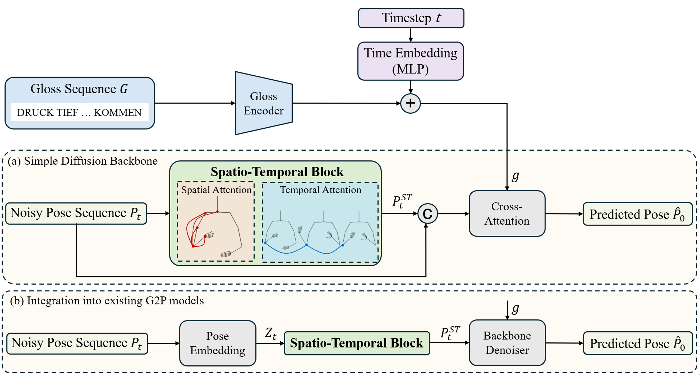

## Qualitative results

The videos compare two base models with and without STB on the test sets of **PHOENIX14T** and **CSL-Daily**:
- **[Sign-IDD](https://github.com/NaVi-start/Sign-IDD)** 
- **[FGDM](https://github.com/yuyiheng-eu/FGDM-main)**

Each video shows three skeletons side by side:
- **Ground truth** (orange)
- **Baseline** (black)
- **Baseline + STB** (black, blue title)

The poses are **raw model outputs** for the test sentence, cut to the ground-truth length. They have no smoothing, post-processing or temporal alignment. All videos play at 25 fps.

## Contents

- [Sign-IDD vs. Sign-IDD + STB: temporal stability](#sign-idd-vs-sign-idd--stb-temporal-stability)
- [FGDM vs. FGDM + STB: fidelity to the ground truth](#fgdm-vs-fgdm--stb-fidelity-to-the-ground-truth)

---

## Sign-IDD vs. Sign-IDD + STB: temporal stability

Sign-IDD produces visible high-frequency jitter in the hands. STB removes most of this jitter while the motion still follows the ground truth.

### PHOENIX14T

**20November_2009_Friday_tagesschau-6574** (78 frames) — *"dabei wird es teilweise sehr windig und auch etwas kühler"* (It will be very windy in places and also somewhat cooler.)  
Gloss: `TEIL WIND MEHR KUEHL AUCH` · [mp4](videos/sign-idd/phoenix/phoenix_01.mp4)

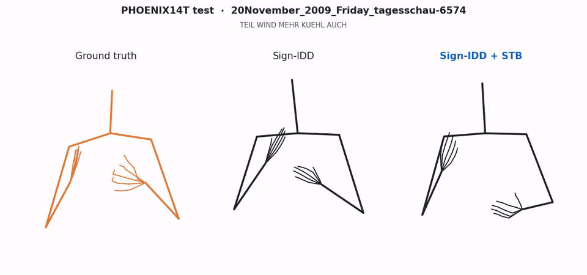

**27May_2010_Thursday_heute-1236** (79 frames) — *"ab sonntag geht es dann wieder abwärts es wird wechselhafter"* (From Sunday it goes downhill again; it becomes more changeable.)  
Gloss: `NAECHSTE SONNTAG WIEDER SCHLECHTER WECHSELHAFT` · [mp4](videos/sign-idd/phoenix/phoenix_02.mp4)

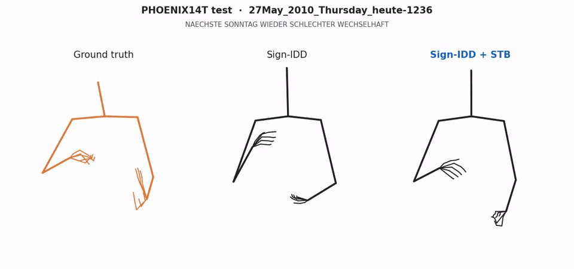

**14August_2009_Friday_tagesschau-73** (129 frames) — *"am sonntag im nordwesten eine mischung aus sonne und wolken mit einigen zum teil gewittrigen schauern"* (On Sunday in the northwest a mix of sun and clouds with some partly thundery showers.)  
Gloss: `SONNTAG NAECHSTE NORDWEST WOLKE SONNE WOLKE GEWITTER REGEN DABEI` · [mp4](videos/sign-idd/phoenix/phoenix_03.mp4)

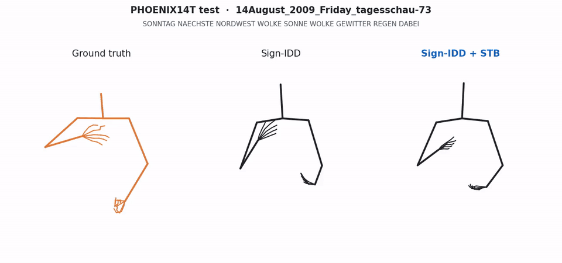

**07April_2010_Wednesday_heute-1619** (71 frames) — *"hallo und guten abend liebe zuschauer"* (Hello and good evening, dear viewers.)  
Gloss: `HALLO GUT ABEND LIEB IX ZUSCHAUER BEGRUESSEN` · [mp4](videos/sign-idd/phoenix/phoenix_04.mp4)

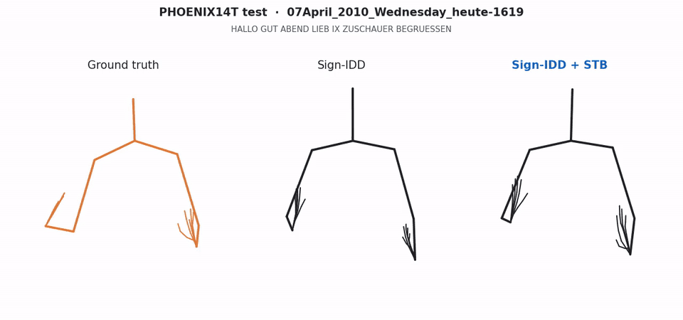

**01May_2010_Saturday_tagesschau-7194** (123 frames) — *"am tag zwölf grad an der ostsee und bis zwanzig grad in niederbayern"* (During the day twelve degrees on the Baltic coast and up to twenty degrees in Lower Bavaria.)  
Gloss: `TAG NORDOST ZWOELF SUED BAYERN IX MAXIMAL ZWANZIG GRAD` · [mp4](videos/sign-idd/phoenix/phoenix_05.mp4)

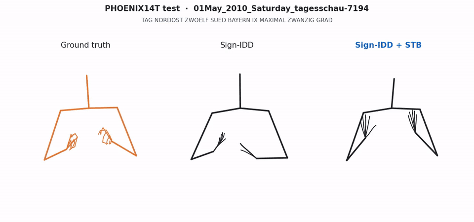

### CSL-Daily

**S004450_P0000_T00** (112 frames) — *"你的作品缺乏创意，不能打动人。"* (Your work lacks creativity and cannot move people.)  
Gloss: `你 做 品 缺少 创 新 不够 感动 人` · [mp4](videos/sign-idd/csl/csl_01.mp4)

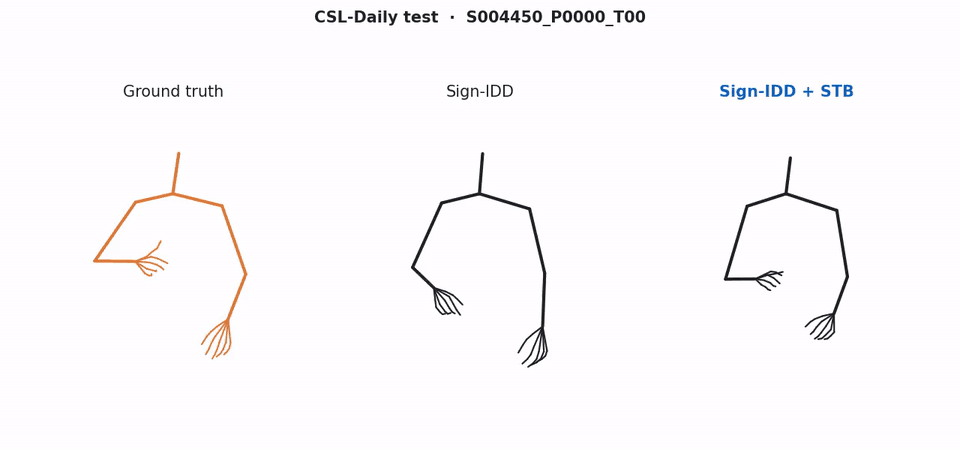

**S000295_P0000_T00** (101 frames) — *"不是，他是去见他同学。"* (No, he went to see his classmate.)  
Gloss: `不是 他 去 见面 同学` · [mp4](videos/sign-idd/csl/csl_02.mp4)

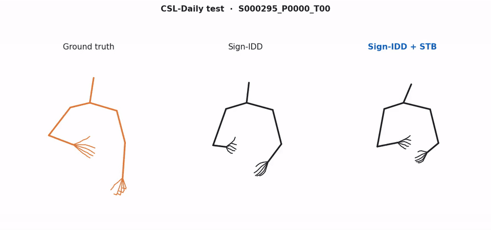

**S006017_P0000_T00** (121 frames) — *"你介绍了这次我和他两校的合作。"* (You introduced the cooperation between his school and mine.)  
Gloss: `你 是 介绍 他 我 2 学校 合作` · [mp4](videos/sign-idd/csl/csl_03.mp4)

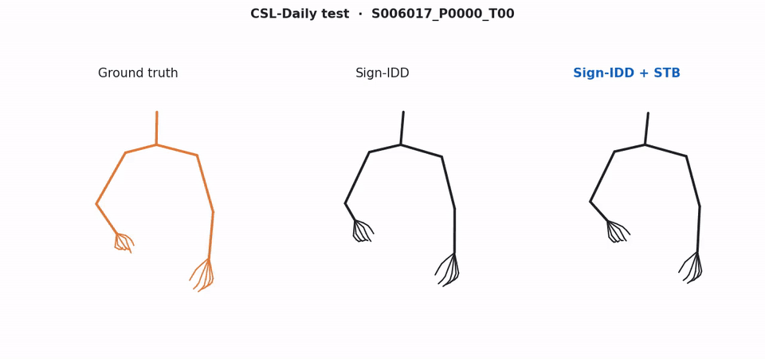

**S005276_P0000_T00** (74 frames) — *"由于采用了新技术，大大降低了钱财开销。"* (Thanks to the new technology, costs were greatly reduced.)  
Gloss: `用 新 技术 降 花钱` · [mp4](videos/sign-idd/csl/csl_04.mp4)

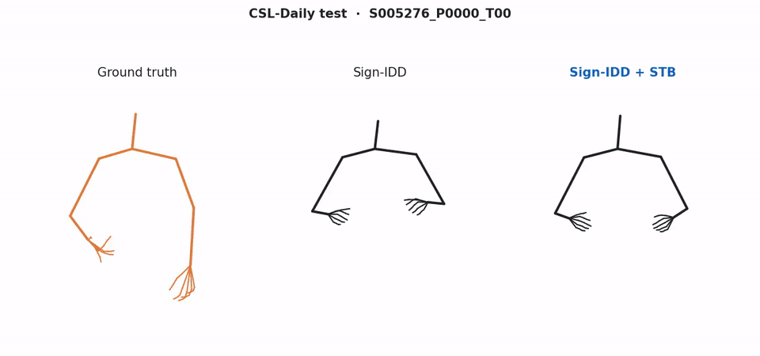

**S002092_P0007_T00** (120 frames) — *"他一听到自己被录取的消息，情绪一下子兴奋起来了。"* (As soon as he heard he had been admitted, he became excited.)  
Gloss: `听 自己 录取 成功 心 兴奋 兴奋` · [mp4](videos/sign-idd/csl/csl_05.mp4)

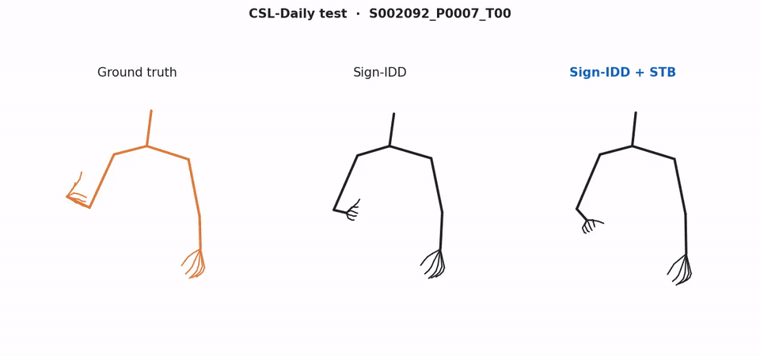

---

## FGDM vs. FGDM + STB: fidelity to the ground truth

FGDM already produces smooth motion, so here STB improves accuracy: the arms and hands follow the ground-truth pose more closely.

### PHOENIX14T

**24September_2009_Thursday_heute-6081** (82 frames) — *"in dieser nacht fällt noch etwas regen im bayerischen wald"* (Tonight there will still be some rain in the Bavarian Forest.)  
Gloss: `IN-KOMMEND HIER NACHT BAYERN HIER WALD BISSCHEN REGEN` · [mp4](videos/fgdm/phoenix/phoenix_01.mp4)

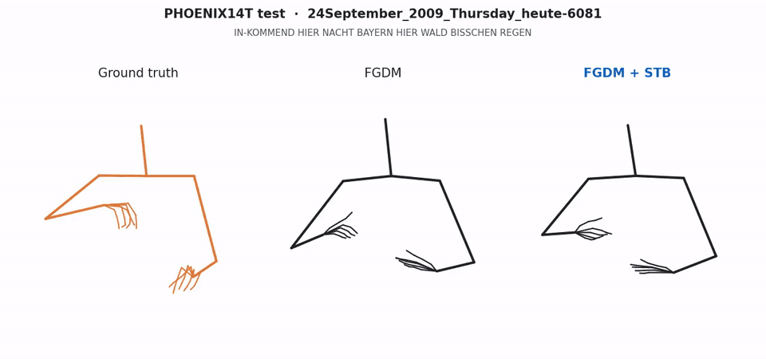

**06January_2010_Wednesday_tagesschau-7728** (93 frames) — *"es sorgt nämlich am und ab freitag dafür dass es bei uns stärker schneit"* (From Friday on, it will snow more heavily here.)  
Gloss: `AB FREITAG MEHR SCHNEE` · [mp4](videos/fgdm/phoenix/phoenix_02.mp4)

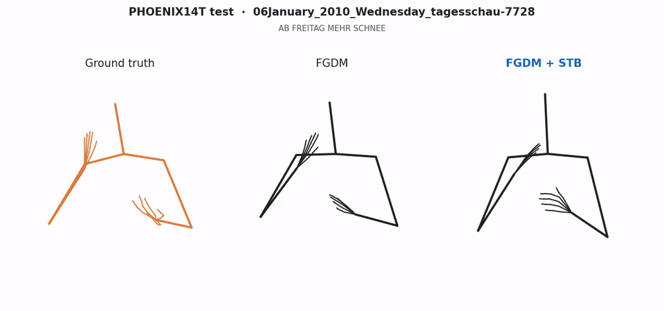

**28October_2009_Wednesday_tagesschau-4537** (127 frames) — *"heute nacht gibt es im norden und nordosten viele wolken örtlich regnet oder nieselt es etwas"* (Tonight many clouds in the north and northeast, with rain or drizzle in places.)  
Gloss: `HEUTE NACHT NORD NORDOST IX REGEN` · [mp4](videos/fgdm/phoenix/phoenix_03.mp4)

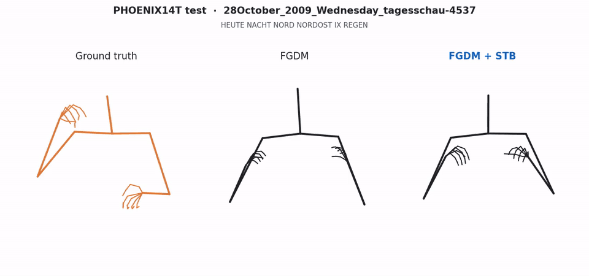

**10August_2009_Monday_heute-6897** (81 frames) — *"entweder über den teletext oder auch über das internet"* (Either via teletext or via the internet.)  
Gloss: `ANKLICKEN TEXT ODER INTERNET ANSCHAUEN KOENNEN` · [mp4](videos/fgdm/phoenix/phoenix_04.mp4)

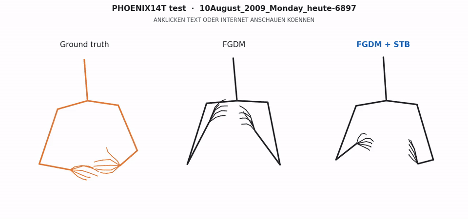

**20October_2010_Wednesday_tagesschau-8214** (77 frames) — *"in der südwesthälfte morgen teils wolken teils längere zeit sonnenschein"* (In the southwest half, partly cloudy tomorrow, partly long spells of sunshine.)  
Gloss: `SUED MORGEN WOLKE TEIL SONNE` · [mp4](videos/fgdm/phoenix/phoenix_05.mp4)

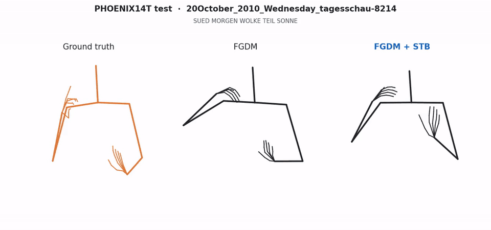

### CSL-Daily

**S005069_P0003_T00** (70 frames) — *"抄袭别人的答案是违规的。"* (Copying other people's answers is against the rules.)  
Gloss: `抄 别 人 答案 是 违反` · [mp4](videos/fgdm/csl/csl_01.mp4)

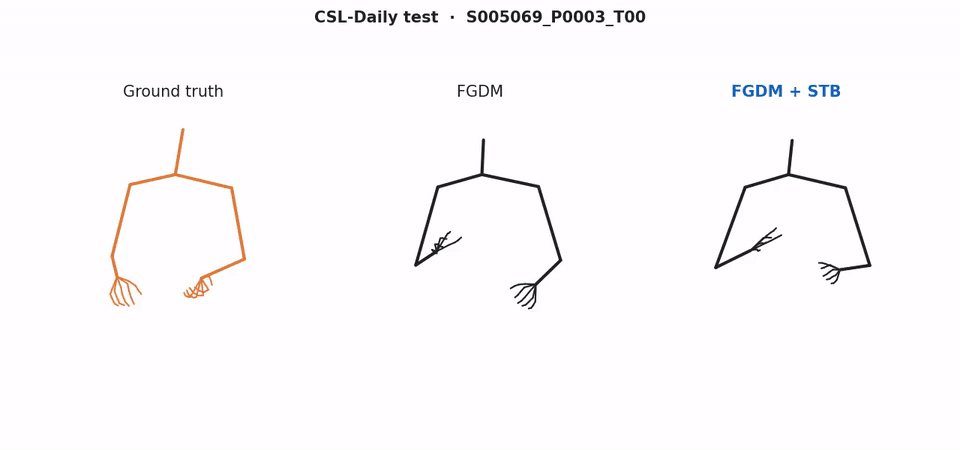

**S004988_P0000_T00** (121 frames) — *"对同学身上的缺点，我们应当是帮助而不是嘲笑。"* (We should help classmates with their shortcomings, not laugh at them.)  
Gloss: `同学 缺点 我们 应该 帮助 不 嘲笑` · [mp4](videos/fgdm/csl/csl_02.mp4)

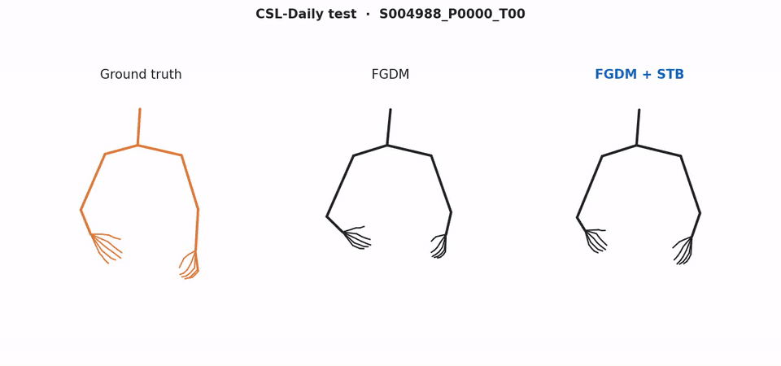

**S002403_P0007_T00** (144 frames) — *"我通过写信的方式告诉了他这个好消息。"* (I told him the good news by writing a letter.)  
Gloss: `我 通过 写 信 方式 告诉 他 好 消息` · [mp4](videos/fgdm/csl/csl_03.mp4)

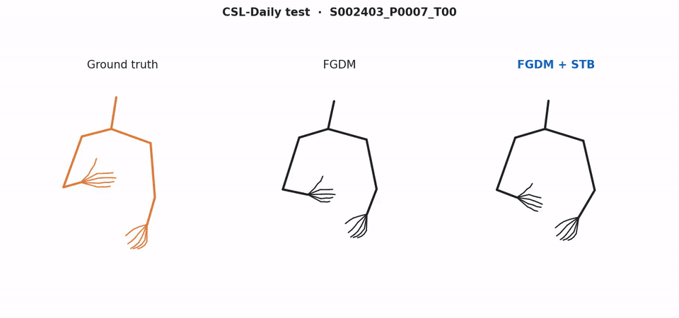

**S007133_P0007_T00** (123 frames) — *"他的膝关节手术非常成功。"* (His knee joint surgery was very successful.)  
Gloss: `他 腿 关节 手术 成功` · [mp4](videos/fgdm/csl/csl_04.mp4)

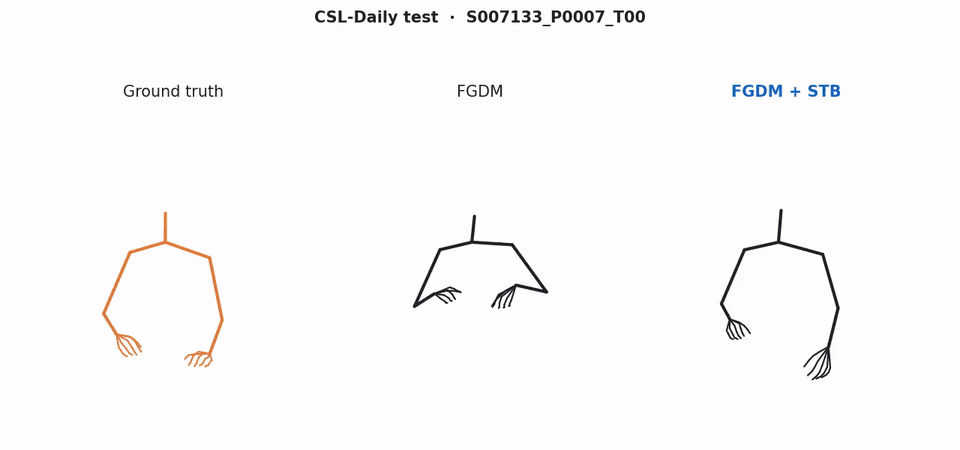

**S006883_P0003_T00** (74 frames) — *"他将来想成为科学家。"* (He wants to become a scientist in the future.)  
Gloss: `他 后 想 做 科学 房子` · [mp4](videos/fgdm/csl/csl_05.mp4)

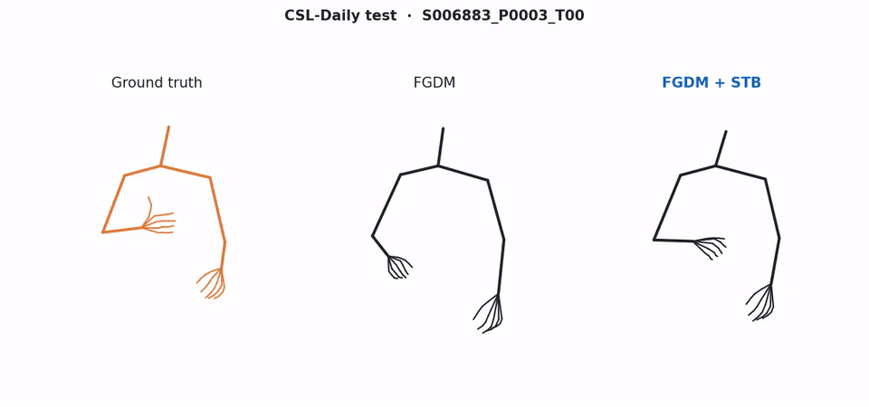

